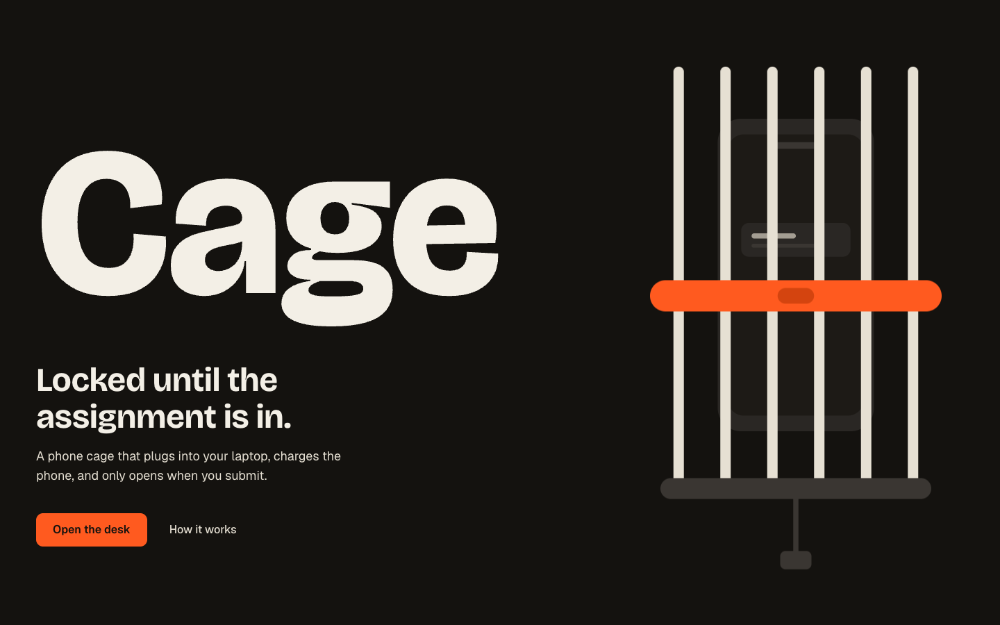

<p align="center">
  
</p>

# Cage

Lock your phone until the assignment is in.

**Live:** <https://cage-sigma.vercel.app>

A two-device demo of a phone cage that plugs into your laptop: the laptop runs the desk (`/desk`), the phone scans a QR code and becomes the locked screen (`/phone/CODE`). Submitting the assignment on the laptop unlocks the phone.

## Modes

- **Timer**: lock for 25, 50 or 90 minutes.
- **Assignment**: lock until the (mock) LMS submit button is pressed.
- **Watch over me**: say "I want to write my essay, watch over me". The camera stays on and BlazeFace checks that a person is in frame. Leave for 10 seconds without pressing Break and you get a strike, +5 minutes, and both screens tell you to come back. Nothing is uploaded.

Guardrails: two 5-minute breaks per session, a two-step emergency unlock, and a visible timer and progress bar on both screens.

## Design

The cage is meant to feel like an industrial object with consumer polish: warm near-black, bone text, one safety-orange accent, and a timer big enough to read from across the room. Elevation comes from lightness steps, not shadows or gradients.

| | |
|---|---|
| Type | Bricolage Grotesque (display) / Geist Sans (body) / JetBrains Mono (timers, codes) |
| Color | `#14120F` ink · `#F3EFE6` bone · `#FF5A1F` accent · `#6FAE6A` unlocked |
| Motion | Motion for React, one easing `cubic-bezier(0.23, 1, 0.32, 1)`, 140 ms controls, 250 ms reveals, spring latch on lock |

Full design rules are in [`DESIGN.md`](DESIGN.md).

## Stack

Next.js App Router, Tailwind v4, Motion, MediaPipe face detection, Upstash Redis. Hosted on Vercel.

## Run locally

```bash
npm install
npm run dev
```

Open `/desk` on the laptop and scan the QR code with your phone (same network, or use the deployed URL). Without Redis env vars the session store falls back to in-memory, which only works on a single dev server.
